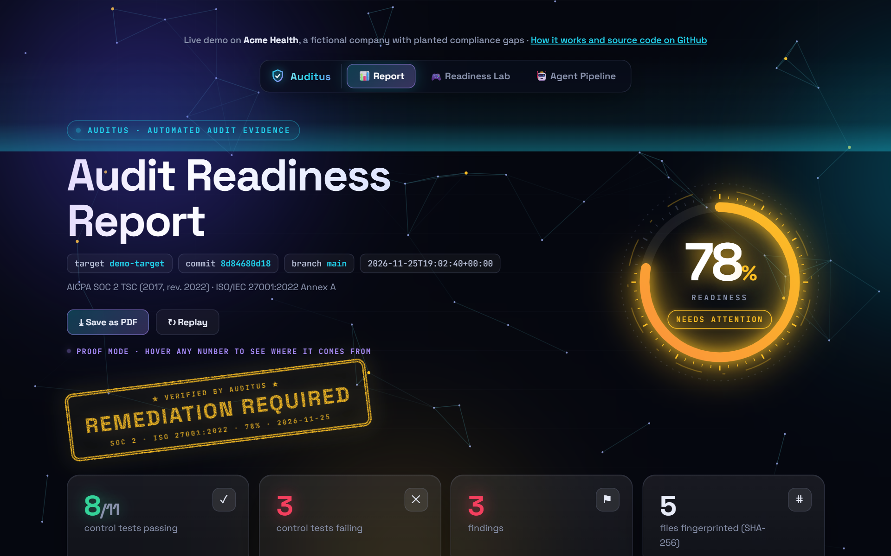
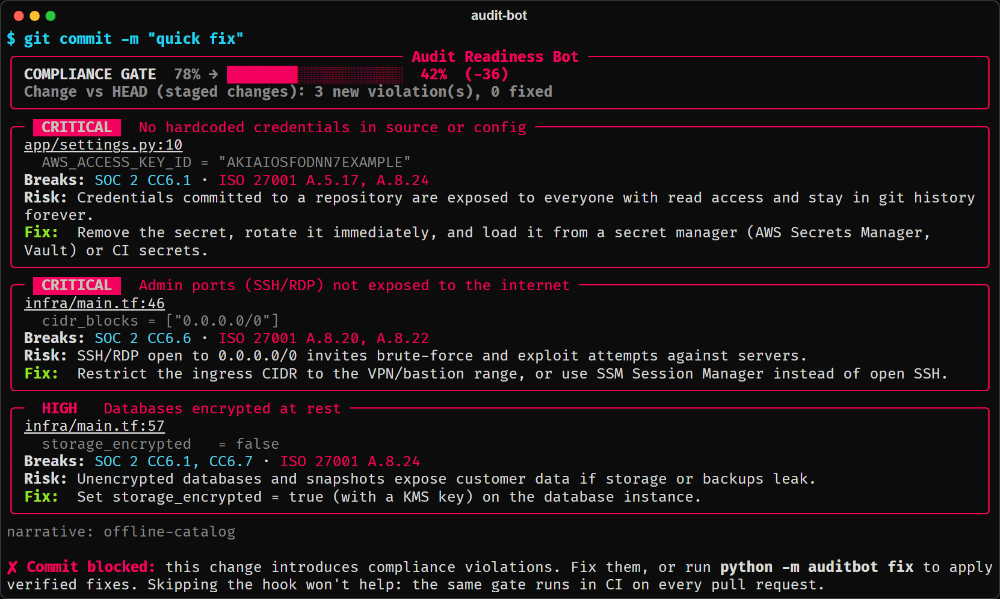
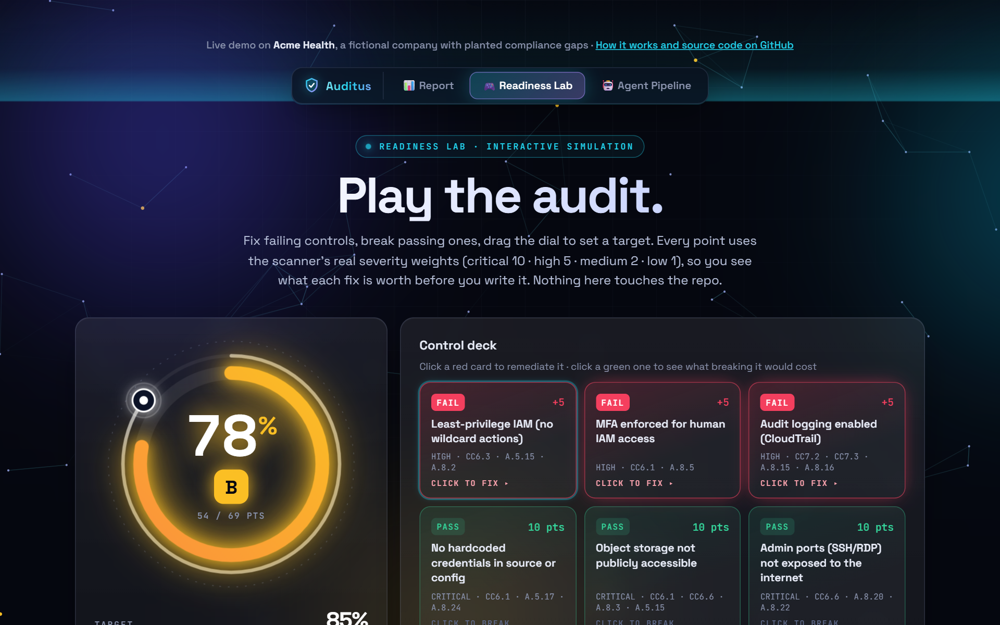
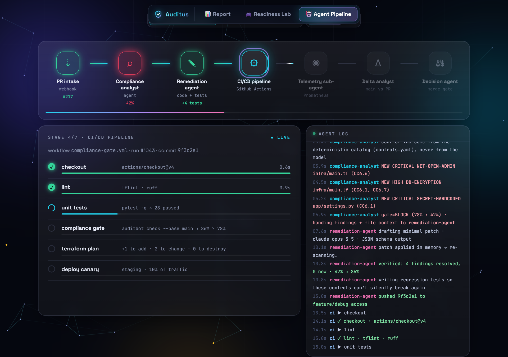
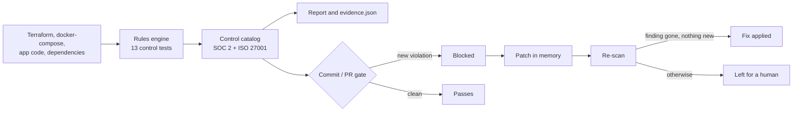

# Audit Readiness Bot (Auditus)

**Compliance checks that run before the commit, not months later in the audit.**

A Python CLI that scans infrastructure code and app config, maps every finding to **SOC 2** and **ISO/IEC 27001:2022** controls, blocks commits that introduce a violation, and applies only the fixes that a re-scan proves correct.

Individual project built by [Leya Sherman](https://leyasherman.github.io/portfolio/) at a two-hour hackathon.

### [▶ Open the live demo](https://leyasherman.github.io/audit-readiness-bot/)

[](https://leyasherman.github.io/audit-readiness-bot/)

## The problem

Audit evidence is usually collected by hand, long after the code has shipped. Meanwhile one "quick fix" can open SSH to the internet or switch off database encryption, and nobody connects that line to the control it breaks. AI coding assistants add new risks: package names that don't exist, pasted secrets, and instructions hidden in the files that agents read.

## See it work

Acme Health is a fictional company with three planted gaps. It starts at **78%** audit readiness.

| Step | Readiness | What happens |
|---|---|---|
| Baseline scan | **78%** | Finds an IAM wildcard, missing MFA and missing CloudTrail |
| A developer commits a "quick fix" | **42%** | SSH open to the world, DB encryption off, hardcoded AWS key: **commit blocked** |
| `fix` runs | **86%** | 4 patches applied, each verified by a re-scan; 2 findings left for a human decision |
| Commit again | **86%** | **Commit passes**, and the CloudTrail gap is recorded as fixed |



## What's in the live demo

- **Report:** the score, findings, control mapping and a SHA-256 fingerprint of every scanned file. Hover over any number to see where it comes from.
- **Readiness Lab:** a playable what-if. Fix or break controls, set a target score, and see what each fix is worth. It uses the scanner's own weights.
- **Agent Pipeline:** a concept view of a pull request moving through compliance agents to a merge decision. The agent steps and telemetry are **simulated**; the scores are computed from the scan's control tests.

| Readiness Lab | Agent Pipeline (simulated) |
|---|---|
|  |  |

## How it works



- **Control IDs can't be hallucinated.** Detection and mapping are deterministic and live in [`controls.yaml`](auditbot/controls.yaml). The language model never chooses a control.
- **No patch is trusted blindly.** Each fix is applied in memory and re-scanned. It is kept only if the violation disappears and no new one appears.
- **AI is optional.** With an `ANTHROPIC_API_KEY`, Claude writes risk explanations, the executive summary and patches. Without a key, or on any error, built-in text and templates take over, so the gate keeps working.
- **The score is transparent.** It is the severity-weighted share of applicable tests that pass (critical 10, high 5, medium 2, low 1).

## Checks for AI-generated code

| Risk | Check | What it looks for |
|---|---|---|
| Hallucinated or typosquatted packages | `DEP-TYPOSQUAT` | Known squats, look-alike names, import names used as packages (`sklearn`) and small typos (`reqeusts`, `axois`). `--online` also asks PyPI/npm whether the package exists and how old it is. |
| Hardcoded secrets | `SECRET-HARDCODED` | AWS, OpenAI, Anthropic, GitHub, Stripe, Slack and Google keys, private keys, passwords, database URLs |
| Prompt injection into coding agents | `AI-AGENT-CONTEXT` | Injected instructions in `AGENTS.md`, `CLAUDE.md`, `.cursorrules` and similar files; invisible Unicode |
| Insecure shortcuts | `APP-INSECURE-CONFIG` | SQL or shell built from strings, XSS sinks, TLS or JWT verification off, client-side authorization, debug mode, CORS `*` |

## Run it

Needs Python 3.10+ and Git. Developed and tested on Windows.

```bash
git clone https://github.com/leyasherman/audit-readiness-bot
cd audit-readiness-bot
python -m venv .venv
source .venv/Scripts/activate        # Git Bash; PowerShell: .venv\Scripts\activate; macOS/Linux: source .venv/bin/activate
pip install -r requirements.txt
python demo/setup_demo.py
python -m auditbot scan demo-target
```

The report is written to `audit-output/report.html`. On Windows, `setup.ps1` does the setup steps for you.

**Replay the demo**

```bash
python demo/risky_change.py                       # the bad "quick fix"
git -C demo-target add -A
git -C demo-target commit -m "quick fix"          # blocked: 78% -> 42%
python -m auditbot fix demo-target                # verified fixes: 86%
git -C demo-target add -A
git -C demo-target commit -m "remediated"         # passes
python demo/setup_demo.py                         # reset
```

**Other commands**

```bash
python -m auditbot scan https://github.com/bridgecrewio/terragoat   # any public git repo
python -m auditbot check PATH --base origin/main                    # only new violations
python -m auditbot fix PATH --dry-run                               # preview verified fixes
python -m auditbot install-hook PATH                                # git pre-commit gate
python -m auditbot scan demo/vibe-coded-app --online                # AI-generated-code demo
python -m unittest -v                                               # 24 tests
```

## Results on public repositories

Re-scanned in November 2026, offline mode. The first four are insecure on purpose, so a low score is expected.

| Repository | Readiness | Findings | Examples |
|---|---|---|---|
| `bridgecrewio/terragoat` | 0% | 36 | Public storage and database, open SSH, unencrypted databases, hardcoded passwords |
| `juice-shop/juice-shop` | 55% | 24 | Default credentials, RSA private key in source |
| `WebGoat/WebGoat` * | 29% | 24 | Hardcoded passwords and keys in Java |
| `jehy-security/bwapp` * | 0% | 13 | Database password in `admin/settings.php` |
| `terraform-aws-modules/terraform-aws-rds` * | 57% | 2 | Password in an example, no CloudTrail |

\* Few control tests apply to these repositories, so the bot attaches a limited-coverage warning to the score.

## Limitations

- Detection is pattern-based. These scans include false positives: invisible characters that are legitimate in Juice Shop's translation files, `innerHTML` in a vendored editor in WebGoat, and the real package `tslint` flagged as a look-alike in TerraGoat.
- It is a readiness signal, not an audit opinion, and not a replacement for a full SAST/DAST tool. A dependency false positive can be silenced with `# auditbot: allow` on its line, or `"auditbot": {"allow": ["name"]}` in `package.json`.
- Tests, fixtures and vendored libraries in common locations are skipped.
- The Claude-written explanations and patches have not been tested with a live API key yet. The published demo and the results above use the offline text and templates. The [example GitHub Action](demo-target/.github/workflows/compliance-gate.yml) has not been run on GitHub yet.
- `demo-target/` and `demo/vibe-coded-app/` contain **fictional, deliberately insecure code**. Do not deploy them or install their dependencies.

## Tech

Python · Rich · Jinja2 · PyYAML · Claude API · vanilla JavaScript and SVG · Git hooks · GitHub Actions
